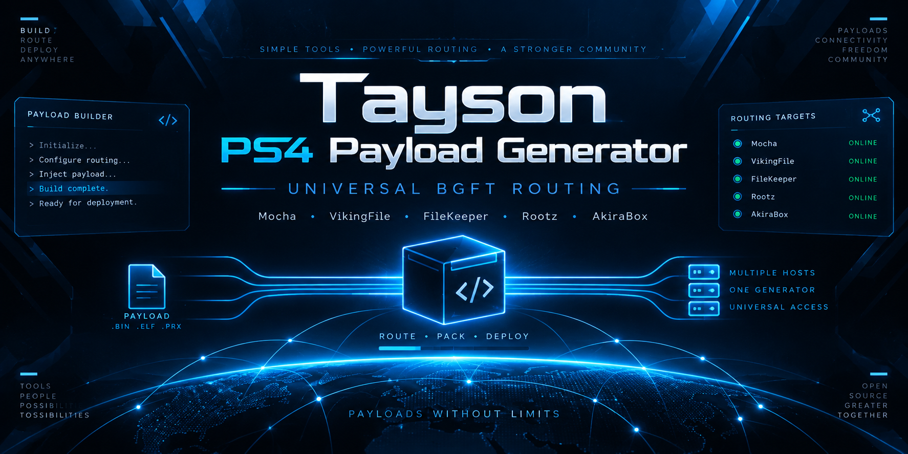

  

<h1 align="center">Tayson PS4 Payload Generator</h1>

  Aplicativo Android para preparar e enviar payloads ao PS4 com suporte a múltiplos provedores.

## Versão estável

**3.4.3**

Principais recursos:

- validação de PKG;
- geração e envio de payload;
- metadados e artwork;
- histórico local;
- suporte a Mocha, VikingFile, FileKeeper, Rootz e AkiraBox;
- integração com Worker complementar.

## Download

Use somente a release estável mais recente publicada neste repositório.

## Privacidade

O projeto evita expor ou documentar publicamente detalhes operacionais que possam incluir:

- URLs temporárias;
- tokens;
- cookies;
- endereços IP;
- rotas internas;
- nomes de bindings;
- detalhes de infraestrutura.

Esses dados não devem ser incluídos em issues, screenshots ou logs públicos.

## Uso responsável

Destinado a desenvolvimento, homebrew, testes e gerenciamento de conteúdo que o usuário tenha autorização para utilizar.

O projeto não distribui jogos, licenças, chaves ou conteúdo protegido.

## Licença

MIT. Consulte [LICENSE](LICENSE).
